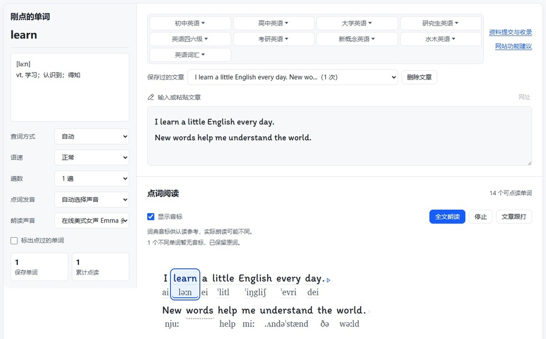
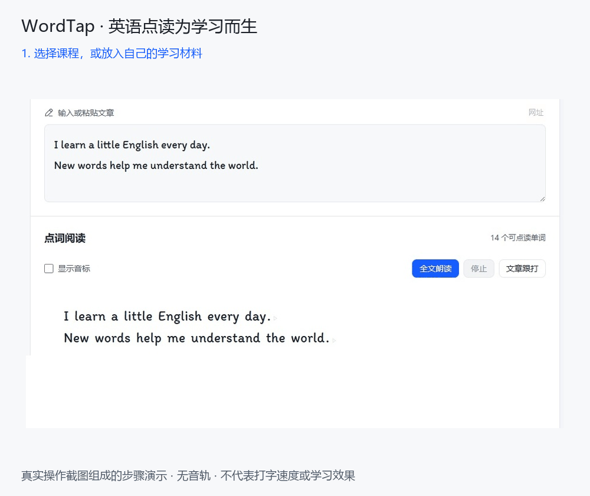

# WordTap — 英语点读为学习而生

**点词查义 · 听读发音 · 文章跟打**

WordTap 是一款以英语点读为核心的开源英语学习工具。选择课文、词库或自己的英文材料，点击单词查释义、看音标、听发音，再用同一份材料积累词汇并练习文章跟打。

Open-source English learning with tap-to-read dictionary lookup, pronunciation, vocabulary learning and article typing practice. The interface and dictionary definitions are primarily in Chinese.

**[开始学习](https://wordtap.cn/)** · [学习教程](docs/english-learning-guide.md) · [本地运行](#本地运行) · [反馈问题](https://github.com/hawkhai/wordtap.cn/issues/new/choose)

[](https://github.com/hawkhai/wordtap.cn/actions/workflows/verify.yml)
[](LICENSE)

<a href="public/media/english-learning/02-lookup.jpg"></a>

*在原句中点查 `learn`，结合释义、音标与听读理解内容，再练习跟打。截图来自 2026-10-21 本地构建预览，入口可能随版本更新。*

## 核心功能

| 学习任务 | 可以做什么 |
| --- | --- |
| 点读理解 | 点击原文单词查中文释义、看音标、听发音；按需显示正文音标 |
| 听读练习 | 单词、句子与全文朗读，支持语速、遍数及全文暂停／继续 |
| 积累词汇 | 查看查词记录；从词库、课文和例句学习单词 |
| 拼写与输入 | 文章或选区跟打，查看字母纠错提示，确认每句后继续 |
| 保存与续学 | 在当前浏览器保存文章、菜单位置和跟打草稿，下次接着练 |
| 使用学习材料 | 选择内置课程、词库，或输入、粘贴自己的英文材料 |

## 适合怎样的学习

适合英语自学者、学生、四六级／考研备考者，以及准备材料或陪伴学习的教师、家长。主要界面和查词释义为中文，可以围绕同一份材料完成理解、听读和拼写练习。

已有新概念、水木、研究生、大学、人教版英语及四六级／考研材料；另有 23 套词库、1,181 篇词汇文章，每篇最多 100 词。材料来源、缺失内容和许可说明见开发文档中的课程资料入口。

## 在线使用

1. 打开 [wordtap.cn](https://wordtap.cn/)，无需注册。
2. 选择课文或词库，或者输入、粘贴自己的英文材料。
3. 点击生词查义、看音标并听发音，用句末按钮听整句。
4. 进入文章跟打练习拼写；查看“我的单词”，下次在同一浏览器、同一站点继续学习。

[跟着五张操作图完成第一次学习](docs/english-learning-guide.md)。基础点读、ECDICT 查词和跟打无需安装 Gateway；浏览器语音可用情况取决于设备与浏览器。

<details>
<summary>看 20 秒学习步骤：点读查词 → 听读入口 → 跟打纠错 → 完成练习</summary>

<a href="public/media/english-learning/wordtap-20s.gif"></a>

动图由五张真实操作截图组成，无音轨；完整步骤与原创例句见[英语学习入门教程](docs/english-learning-guide.md)。

</details>

<a id="开发命令"></a>

## 本地运行

Web 使用 Vue 3、TypeScript 和 Vite。需要 Node.js 20.19+ 与 npm；先安装 Git，再运行：

```bash
git clone https://github.com/hawkhai/wordtap.cn.git
cd wordtap.cn
npm ci
npm run dev
```

打开终端显示的本地地址。已有工作区时直接进入其根目录运行安装与开发命令。

开发、构建与统一验证只需 Node 和仓库内的发布数据。可选 Windows Gateway 独立交付，运行 Web 无需编译 Gateway，也无需 Python 或 Rust。

```bash
npm run build
npm run verify
```

两条命令按需选用：`build` 包含发布数据检查、类型检查、前端打包、静态页面生成与资源校验；`verify` 自带一次构建并追加业务、响应式和仓库检查。

## 学习数据与使用边界

- 学习记录保存在当前浏览器，不自动跨设备同步。换设备或清理浏览器前先导出备份，核对备份内容后再迁移。
- “我的单词”中的单词导出只包含单词；本项目“考试学习”页的“导出学习数据”提供完整学习备份。
- 离线仅限已经缓存的页面、词典分片和资源；首次加载、未缓存资源及在线查词／朗读仍需网络。
- 启用在线服务时，相应单词或文本可能发送给服务方。跟打用于字母拼写与输入练习，不提供口语评分或语法批改。

## 开发与维护文档

- [开发与维护指南](docs/development.md)：项目目录、命令、数据库、缓存、查词与朗读流程、Gateway 接口。
- [产品指南](WORDTAP_PRODUCT_GUIDE.md)：学习定位、功能边界和文案约定。
- [课程接入协议](COURSE_INTEGRATION_PROTOCOL.md)：数据格式、学习入口与课程验证。
- [界面风格](STYLE_GUIDE.md)与[界面验收标准](UI_PRACTICE_STANDARD.md)：沿用现有设计与响应式约定。
- [GitHub 设置交接清单](docs/github-maintenance.md)：About、Topics、分享封面、安全设置及发布后验收。

## 反馈与参与

在[本仓库反馈入口](https://github.com/hawkhai/wordtap.cn/issues/new/choose)选择“问题反馈”“功能建议”或“课程勘误”，也可以提交空白 Issue。请说明页面或提交哈希、运行环境和可复现的最小示例；课程勘误附上原文位置和来源依据。

本仓库接收问题反馈与改进建议。PR 请说明改动目的、验证结果；界面调整附截图，内容修改注明来源。不要公开凭据、个人学习备份或漏洞利用细节。

如果这次学习对你有帮助，欢迎给 [WordTap 点个 Star](https://github.com/hawkhai/wordtap.cn)，支持后续维护。

贡献流程见[贡献指南](CONTRIBUTING.md)，安全问题按[安全策略](SECURITY.md)私下报告。

## 致谢

- [ECDICT](https://github.com/skywind3000/ECDICT)：英汉词典数据，转换为按需加载的静态分片。
- [english-vocabulary](https://github.com/KyleBing/english-vocabulary)：英语词库及例句数据。
- 其他内容与字体来源见 [THIRD_PARTY_NOTICES.md](THIRD_PARTY_NOTICES.md)。

## 第三方内容

词典、字体、课程数据和发音音频不随本项目原创代码改用 Apache-2.0。它们继续适用各自的上游许可证或权利条件，详见 [`THIRD_PARTY_NOTICES.md`](THIRD_PARTY_NOTICES.md)。

## 许可证与派生项目署名

本项目原创代码和文档采用 [Apache License 2.0](LICENSE) 发布。分发 fork 或其他派生版本时：

1. 按照 Apache-2.0 保留 `LICENSE`、`NOTICE` 以及适用的第三方声明。
2. 在派生项目 README 的显著位置明确注明原项目地址和项目网站。可以直接使用下面这段文字：

> 本项目基于 [WordTap](https://github.com/hawkhai/wordtap.cn) 开发；原项目网站：[https://wordtap.cn/](https://wordtap.cn/)。

`NOTICE` 的署名保留义务来自 Apache-2.0 第 4(d) 节；README 中的写法是本项目的派生项目署名规范，不修改 Apache-2.0 正文。完整署名信息见 [`NOTICE`](NOTICE)。
